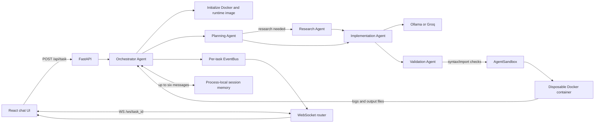

# EverythingLLM Architecture

EverythingLLM is a chat-style AI coding task runner. A user selects Ollama or Groq, submits a request, and receives streamed planning, generated code, Docker execution logs, and result artifacts. Users can request changes in the same session; failed code is validated and can be regenerated with previous conversation context.

## System overview



## Components

### Frontend

The Vite React/TypeScript app provides a chat shell with a persistent scrollable conversation, dark/light themes, Ollama/Groq provider selector, Groq key/model fields, and a bottom composer. Each agent response includes Planning, Code, Executing, and Result tabs. The frontend submits a task over HTTP, then consumes events over a task-specific WebSocket. Results support Markdown, CSV tables, inline images, downloads, and HTML graphs in a sandboxed iframe.

### Backend API and event stream

- `POST /api/task` accepts `prompt`, `provider`, optional `groq_api_key`, optional `groq_model`, and optional `session_id`. Groq selection requires both key and model; invalid requests receive HTTP 422.
- The endpoint creates a task UUID and event bus, schedules the orchestrator, and returns `task_id` plus `session_id`.
- `WS /ws/{task_id}` consumes the event bus and sends each event as JSON. Bus completion ends the WebSocket stream.
- Event types include `planning`, `code`, `executing`, `log`, `retry`, `result`, and `error`.
- Artifact entries contain `name`, MIME `type`, `encoding: "base64"`, and base64 `data`.

### Agent pipeline

1. **Docker initialization:** Before model work, the backend pings Docker and ensures `DOCKER_IMAGE` is present, pulling it if absent.
2. **Planning Agent:** Creates task steps and decides whether current or specialized information requires web lookup. It can access only the restricted sandbox tool, not the host Docker client or filesystem.
3. **Research Agent:** Performs bounded public web searches only when requested by planning. Retrieved page content is untrusted reference material.
4. **Implementation Agent:** Uses the selected Ollama or Groq provider to create a complete Python script and requirements declaration.
5. **Validation Agent:** Parses/compiles Python before execution, discovers third-party imports and adds corresponding pip dependencies, and checks stdout for common explicit failure messages before accepting an exit-code-zero result.
6. **Execution:** `AgentSandbox` runs the validated script in a fresh Docker container.
7. **Repair loop:** Syntax failures, execution exceptions, timeouts, nonzero exits, and recognized printed failure output are sent to the model with the failed code and logs. Each repair prompt also includes the previous six retained session messages. Up to `CODE_RETRY_ATTEMPTS` repairs are made after initial generation.
8. **Result:** Only a successful validated execution is published as `result`. Otherwise, a final `error` event is emitted.

## Task data flow

```mermaid
sequenceDiagram
  participant Browser
  participant API as FastAPI tasks router
  participant Orchestrator
  participant LLM as Ollama/Groq
  participant Docker
  participant Bus as EventBus/WebSocket

  Browser->>API: POST /api/task (prompt/provider/session)
  API-->>Browser: task_id + session_id
  Browser->>Bus: Connect /ws/{task_id}
  API->>Orchestrator: Start background task
  Orchestrator->>Docker: Ping daemon, ensure image
  Orchestrator->>LLM: Planning; optional research; implementation
  LLM-->>Bus: planning/code events
  Orchestrator->>Orchestrator: Validate syntax and imports
  Orchestrator->>Docker: Install dependencies and run code
  Docker-->>Bus: Execution logs
  Docker-->>Orchestrator: Exit status + stdout + output files
  alt execution valid and successful
    Orchestrator-->>Bus: result with base64 artifacts
  else failure
    Orchestrator->>LLM: Prior 6 messages + failed code + logs
    LLM-->>Orchestrator: Repaired script
  end
  Bus-->>Browser: Stream task events
  Orchestrator->>Bus: Finish sentinel
  Bus-->>Browser: Close WebSocket
```

The event bus buffers early events, so the task may publish before the browser finishes opening its WebSocket. LLM and Docker SDK streams are blocking; they are bridged into the async app using background executor threads and `asyncio.Queue` instances.

## Docker execution and artifacts

Each execution uses the configured `python:3.11-slim` image by default. The backend creates a disposable container with configured memory and CPU limits, injects an in-memory archive containing `/app/main.py` and `/app/run.sh`, and does not mount host directories. The runner:

1. Creates `/app/.venv` and activates it.
2. Installs declared and statically discovered third-party dependencies with pip.
3. Runs Python unbuffered so logs stream promptly.
4. Produces generated files under `/output/`.
5. Streams logs, waits for completion, collects files, then force-removes the container in cleanup.

Execution has a configurable timeout. Docker containers have network connectivity for pip and public API requests. This is isolation, not a guarantee that generated code is trustworthy: inspect code, avoid supplying secrets in prompts, and use appropriate host Docker security controls. Dynamic imports may not be discovered by static validation and should be listed in `# REQUIREMENTS`.

Charts should use Plotly and be saved as standalone HTML under `/output/`. The Docker service returns artifacts as MIME-typed base64 payloads; the frontend previews HTML in a sandboxed iframe, images as data URLs, and CSV as a table.

## Providers and configuration

Backend defaults are declared in `backend/config.py`; an optional `backend/.env` is ignored by Git. Relevant settings include Ollama host/model, default Groq model for internal calls, Docker image, execution timeout, retry count, session message cap, memory limit, and frontend CORS origin.

For user-selected Groq tasks, the frontend sends the API key and selected model per request. Both are required by the API. The frontend does not persist the key, and the backend does not put it into session memory or logs. Ollama requests omit Groq credentials and use the configured local model.

Session memory is in-process and non-persistent. It retains up to six user/assistant messages by default; restarting the backend clears it.

## Source map

- `frontend/src/App.tsx`: chat shell, theme and provider state
- `frontend/src/components/ChatComposer.tsx`: prompt and provider/model inputs
- `frontend/src/components/ConversationThread.tsx`: chat turns and embedded workflow tabs
- `frontend/src/hooks/useTaskExecution.tsx`: frontend task state and WebSocket event handling
- `frontend/src/lib/api.ts`: HTTP/WebSocket client
- `backend/main.py`: FastAPI setup and router mounting
- `backend/app/routers/tasks.py`: task creation and provider validation
- `backend/app/routers/websockets.py`: per-task event streaming
- `backend/app/services/orchestrator.py`: pipeline, memory context, and repair loop
- `backend/app/services/agents.py`: planning, research, implementation, and coordinating roles
- `backend/app/services/code_validation.py`: syntax, import, and output validation
- `backend/app/services/agent_sandbox.py`: restricted Docker execution interface
- `backend/app/services/docker_service.py`: Docker lifecycle, dependency installation, logs, artifacts
- `backend/app/services/llm_service.py`: Ollama/Groq streaming
- `backend/app/services/event_bus.py`: in-process async event queues
- `backend/app/services/session_memory.py`: bounded session message storage
- `backend/app/prompts/system_prompt.txt`: generated-script contract

## Development and tests

Run the backend from the repository root with `uvicorn backend.main:app --reload`. Run the frontend from `frontend/` with `npm run dev`. Backend tests run with `python -m pytest backend/tests -q`; frontend checks are `npm run build` and `npm run lint`.

See `frontend/README.md` and `backend/README.md` for setup and operational details.
